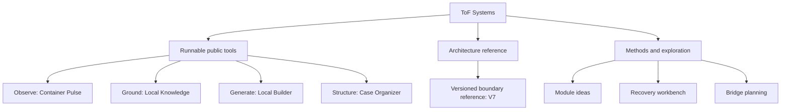

# ToF Systems — Public Projects and Development Context

> German mirror: [06_project-line_DE.md](06_project-line_DE.md) · [Project roles](01_product_line.md) · [Showcase](../README.md)

## What belongs together

**ToF Systems** is the common identity for work on local-first software, self-hosted AI, system architecture, and controlled development. The public GitHub repositories are **separate tools and technical references**, connected by design principles rather than by a single automatic runtime.

Visitors should start with **what each public tool actually does**:

| Role | Repository | Main purpose |
| --- | --- | --- |
| Observe | [Container Pulse](https://github.com/IMaugrenI/tof_container_pulse) | Local read-only infrastructure views. |
| Ground | [Local Knowledge](https://github.com/IMaugrenI/tof_local_knowledge) | Local document search and evidence-grounded answers. |
| Generate | [Local Builder](https://github.com/IMaugrenI/tof_local_builder) | Local AI-assisted building with bounded sources and outputs. |
| Structure | [Local Case Organizer](https://github.com/IMaugrenI/local_case_organizer) | Local registers, timelines, and dossier exports. |

These tools have independent setup instructions and maturity levels. A conceptual ordering does not mean the repositories are pre-integrated.

## Architecture and supporting methods

- [ToF Showcase](https://github.com/IMaugrenI/tof-showcase) explains the public family.
- [Architecture Reference (V7)](https://github.com/IMaugrenI/tof-v7-public-frame) retains an earlier version label while documenting relevant system-boundary ideas.
- [Module Ideas](https://github.com/IMaugrenI/tof-module-ideas) records candidates, not shipped services.
- [Legacy Recovery Workbench](https://github.com/IMaugrenI/tof-legacy-recovery-workbench) separates evidence from interpretation in older material.
- [Bridge Planning Method](https://github.com/IMaugrenI/tof-bridge-planning-method) supports reviewed movement from preparation into planning.

These are **methods or references**, not substitutes for demonstrated product behavior.

## Public navigation map

## About the older project labels

Earlier documents use **ToF / V’eth** and version identifiers such as **V6** and **V7**. Those names describe parts of the development history and remain where they are needed to interpret historical architecture references.

They are **not** the primary public project categories, do not describe the current maturity of each standalone repository, and are not a requirement to understand or run a public tool. Existing repository names and links are retained for continuity.

## What remains private

The broader development work includes non-public architectures, operating contexts, and experiments. Public repositories do not disclose production secrets, private service maps, or private-runtime evidence, and this document does not claim that every architectural idea has been implemented or deployed.

**Use each project's code, current README, and documented checks to assess that project's actual behavior.** Use the method repositories for design principles, not operating-status assertions.

For concrete use cases and handoffs see [Practical workflows](07_product_workflows.md).
