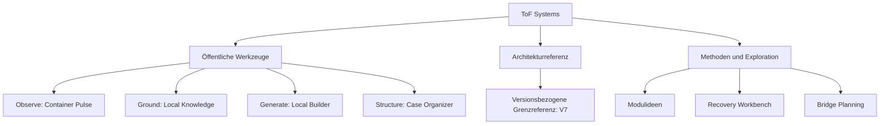

# ToF Systems — Öffentliche Projekte und Entwicklungskontext

> Englische Hauptfassung: [06_project-line.md](06_project-line.md) · [Projektrollen](01_product_line_DE.md) · [Showcase](../README_DE.md)

## Was zusammengehört

**ToF Systems** ist der gemeinsame Rahmen für Arbeiten an lokaler Software, selbst gehosteter KI, Systemarchitektur und kontrollierter Entwicklung. Die öffentlichen GitHub-Repositories sind **eigenständige Werkzeuge und technische Referenzen**. Ihre Verbindung besteht zunächst in gemeinsamen Prinzipien, nicht in einer einzigen automatischen Runtime.

Für Besucher steht an erster Stelle, **was die öffentlichen Werkzeuge tatsächlich machen**:

| Aufgabe | Repository | Hauptzweck |
| --- | --- | --- |
| Observe | [Container Pulse](https://github.com/IMaugrenI/tof_container_pulse) | Lokale, schreibgeschützte Infrastrukturansichten. |
| Ground | [Local Knowledge](https://github.com/IMaugrenI/tof_local_knowledge) | Lokale Dokumentensuche und beleggestützte Antworten. |
| Generate | [Local Builder](https://github.com/IMaugrenI/tof_local_builder) | Lokale KI-gestützte Umsetzung mit begrenztem Quellen- und Ausgaberaum. |
| Structure | [Local Case Organizer](https://github.com/IMaugrenI/local_case_organizer) | Lokale Register, Zeitachsen und Dossier-Exporte. |

Die Werkzeuge besitzen eigenständige Installationswege und unterschiedliche Entwicklungsstände. Eine konzeptionelle Reihenfolge bedeutet keine bereits bestehende technische Integration.

## Architektur und ergänzende Methoden

- [ToF Showcase](https://github.com/IMaugrenI/tof-showcase) erklärt die öffentliche Projektfamilie.
- [Architekturreferenz (V7)](https://github.com/IMaugrenI/tof-v7-public-frame) bewahrt eine ältere Versionsbezeichnung und zeigt übertragbare Prinzipien für Systemgrenzen.
- [Modulideen](https://github.com/IMaugrenI/tof-module-ideas) sammelt Kandidaten, keine ausgelieferten Dienste.
- [Legacy Recovery Workbench](https://github.com/IMaugrenI/tof-legacy-recovery-workbench) trennt bei Altmaterial Belege und Interpretationen.
- [Bridge Planning Method](https://github.com/IMaugrenI/tof-bridge-planning-method) unterstützt die kontrollierte Überführung von Vorbereitung in Planung.

Diese Repositories sind **Methoden oder Referenzen**, keine Ersatznachweise für tatsächlich vorhandene Produktfunktionen.

## Öffentliche Orientierungskarte

## Zu den älteren Projektbezeichnungen

Frühere Dokumente verwenden **ToF / V’eth** und Versionsbezeichnungen wie **V6** und **V7**. Diese Namen gehören zur Entwicklungsgeschichte. Sie bleiben dort erhalten, wo sie zum Verständnis historischer Architekturreferenzen notwendig sind.

Sie sind **nicht** die heutigen öffentlichen Produktkategorien, beschreiben nicht automatisch den Entwicklungsstand einzelner Repositories und sind keine Voraussetzung, um ein öffentliches Werkzeug zu verstehen oder zu starten. Bestehende Repository-Namen und Links bleiben aus Kontinuitätsgründen bestehen.

## Was privat bleibt

Die umfassendere Entwicklungsarbeit enthält nicht öffentliche Architekturen, Betriebskontexte und Experimente. Öffentliche Repositories legen keine produktiven Secrets, privaten Dienstübersichten oder privaten Runtime-Nachweise offen. Dieses Dokument behauptet nicht, dass jede Architekturidee bereits umgesetzt oder ausgerollt sei.

**Für den tatsächlichen Funktionsumfang eines Projekts sind dessen Code, aktuelles README und dokumentierte Prüfungen maßgeblich.** Die Methoden-Repositories beschreiben Prinzipien und keinen Betriebsstatus.

Konkrete Anwendungsfälle und Übergaben: [Praktische Abläufe](07_product_workflows.md).
